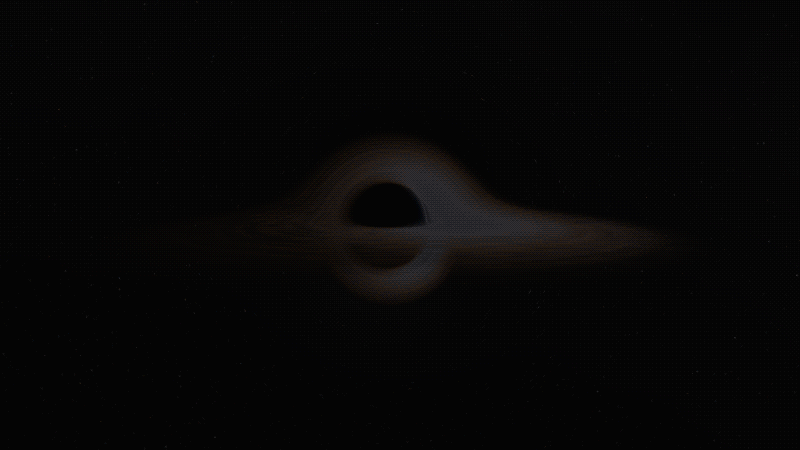
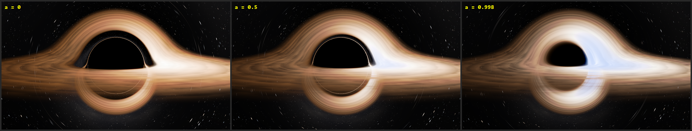
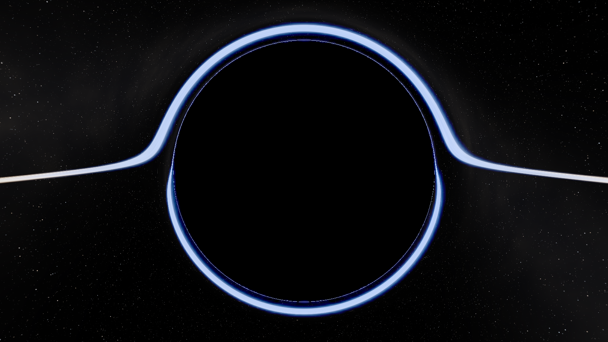
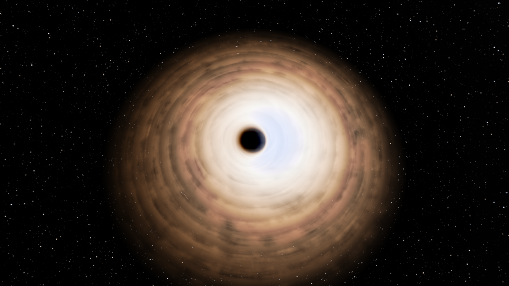

# Black Hole

**A real-time spinning black hole you can fly into. Every pixel is a light ray traced through curved spacetime on your GPU.**

[](https://github.com/OWNER/REPO/actions/workflows/build.yml)
[](LICENSE)




[Watch this in higher quality (MP4)](docs/hero.mp4)

**The same hole at three spins, from the same camera.** As it spins faster, the shadow flattens into a D, the disk reaches closer in and gets hotter, and the gas coming towards you turns blue-white.



## Download and run

**Windows:** get the zip from the [latest release](https://github.com/OWNER/REPO/releases/latest), unpack it and double-click `black_hole.exe`.

You need a GPU with OpenGL 4.3 or newer (nearly anything from about 2015 on) with an up-to-date driver. The program isn't signed, so Windows may warn you the first time. Click "More info", then "Run anyway".

**Things to try:** press <kbd>L</kbd> until a = 0.998 and compare it with <kbd>K</kbd> down to 0. Then press <kbd>F</kbd>, hold <kbd>W</kbd> and keep going through the horizon. Once inside, turn round with the mouse to see the stars behind you.

## Features

- **Real Kerr geodesics in a compute shader.** Spin from 0 to 0.998, with no precomputed tables.
- **Free flight through the horizon** and on down inside, in the local frame of a physical observer. It stops just above the inner horizon.
- **A D-shaped shadow** that matches the exact Kerr values to within one pixel.
- **An accretion disk that follows the spin.** Its inner edge is the innermost stable orbit, with Doppler beaming, gravitational redshift and blackbody colour.
- **Lensed starfield and spacetime grid**, plus bloom and auto-exposure.
- **Live shader editing:** change a shader and press <kbd>R</kbd>.

## Controls

| Input | Action |
|---|---|
| <kbd>F</kbd> | switch between orbit camera and free flight |
| <kbd>K</kbd> / <kbd>L</kbd> | spin down / up (the current `a` is in the window title) |
| <kbd>T</kbd> | accretion disk on / off |
| <kbd>G</kbd> / <kbd>P</kbd> / <kbd>B</kbd> | spacetime grid / Doppler / bloom |
| <kbd>Space</kbd> | pause the disk |
| <kbd>+</kbd> / <kbd>-</kbd> | render resolution (press <kbd>-</kbd> if the frame rate is low) |
| <kbd>[</kbd> / <kbd>]</kbd> | exposure |
| <kbd>1</kbd> <kbd>2</kbd> <kbd>3</kbd> | camera presets (these also leave free flight) |
| <kbd>R</kbd> | reload shaders (edit `build/Release/shaders/*` live) |
| <kbd>H</kbd> | print the controls |
| <kbd>Esc</kbd> | leave free flight, or quit |

**Orbit camera:** left-drag to orbit, wheel to zoom, <kbd>O</kbd> for auto-orbit.

**Free flight:**

| Input | Action |
|---|---|
| <kbd>W</kbd> <kbd>A</kbd> <kbd>S</kbd> <kbd>D</kbd> | forward / left / back / right |
| <kbd>Q</kbd> / <kbd>E</kbd> | down / up |
| <kbd>Shift</kbd> | faster (speed also grows with distance from the hole) |
| Mouse | look around |
| Wheel | field of view, 20 to 150 degrees |

The window title shows the spin, your distance `r`, which observer is holding the camera, and when you are inside the horizon. The orbit camera cannot come closer than distance 2.5, so leaving free flight closer in than that moves you out to it.

## Build from source

Needs CMake 3.24+ and a C++17 compiler. CMake downloads GLFW and GLM by itself.

```
git clone https://github.com/OWNER/REPO.git
cd REPO
cmake -B build -S .
cmake --build build --config Release
```

**Windows:** the program is `build\Release\black_hole.exe`. Or double-click `setup.bat`, which installs CMake and the Microsoft C++ Build Tools if they are missing, builds and starts the program. After that, `run.bat` is enough.

**Linux:** install the packages below first. The program is `build/black_hole`. It uses X11, which also works under XWayland.

```
sudo apt install libx11-dev libxrandr-dev libxinerama-dev libxcursor-dev libxi-dev libgl-dev
```

Windows is the platform this is developed and tested on. Linux is compiled on every push, but it isn't run there.

## Performance

The frame rate depends mostly on your GPU and the window size. The costliest views are close to a fast-spinning hole, where rays wind around it many times. If the frame rate is low, press <kbd>-</kbd> to lower the render resolution.

To measure your own GPU, run `black_hole --size 1920 1080 --spin 0.998 --bench 300`. It prints the average frame time.

## The physics

Units: G = c = 1 and M = 0.5, so the Schwarzschild radius Rs = 2M = 1. The spin `a` on screen is the dimensionless a/M. The comments in [`shaders/blackhole.comp`](shaders/blackhole.comp) explain each step.

| | a = 0 | a = 0.5 | a = 0.9 | a = 0.998 |
|---|---|---|---|---|
| Event horizon r+ | 1.000 | 0.933 | 0.718 | 0.532 |
| Inner edge of the disk (ISCO) | 3.000 | 2.117 | 1.160 | 0.618 |
| Hottest disk temperature | 4800 K | 6200 K | 9800 K | 15700 K |

**Rays** are traced backwards from the camera with Hamilton's equations and RK4, in Kerr-Schild coordinates. There, Kerr spacetime is flat space plus one extra term, and unlike Boyer-Lindquist coordinates they carry straight on through the horizon that things fall into.

**The observer.** A picture only means something once you say who is taking it, so rays are built in the local frame of a physical observer:

- The **orbit camera** is held by a *static* observer, hovering on rockets. That is always possible there, as the ergosphere reaches at most r = 1.
- **Free flight** hands over to a freely falling *rain* observer, the Kerr version of Painleve-Gullstrand. Static observers stop existing at the ergosurface, where `f = 1`, so `f` is the ruler: static below f = 0.05 (r = 20), falling from f = 0.8 (r = 1.25 in the disk plane), and a smooth blend between. Inside the horizon only the falling observer exists.

You steer the position directly, even back out of the horizon, which no real ship could do. At each point you see what the observer passing through there sees, without aberration from your WASD speed.

**Inside the horizon** the universe does not vanish. A falling observer still sees most of the sky behind them, with black ahead: at a = 0 the sky reaches 132 degrees from straight behind at r = 0.7 and 108 degrees at r = 0.1. The view widens by itself on the way down, so the black ahead stays ringed by the sky. The camera stops at r = 0.1, or just above the inner horizon at high spin.



**The disk** starts at the prograde ISCO and follows exact Kerr circular orbits. Each photon's redshift is `g = 1 / (u^t (E + Omega k_phi))`, one line covering Doppler shift, gravity, frame dragging and the camera's own motion. Temperature follows `g F^(1/4)` and brightness `g^4`.



### Simplifications

- The disk's flux has the simple Newtonian shape, so its peak temperature is low by about 2%, 9% and 24% at a = 0.5, 0.9 and 0.998.
- A screen can't show the true brightness range, so very bright gas is compressed and auto-exposure stops down. Stars drop less than they would in a real camera, and have no Doppler shift.
- The disk pattern turns 1.5 times too fast for looks, with no light travel delay.
- The grid is the Schwarzschild funnel at every spin, so it is a schematic for a > 0.

## How the code is organised

- [`shaders/blackhole.comp`](shaders/blackhole.comp): the ray tracer. The physics is explained in its comments.
- [`src/kerr.hpp`](src/kerr.hpp): the same spacetime on the CPU, in double precision: horizons, ISCO, the observers and their tetrads, and where the camera may go.
- [`src/camera.hpp`](src/camera.hpp): the orbit and free-flight cameras.
- [`src/main.cpp`](src/main.cpp): window, input, settings (`struct Settings`), the two render passes, auto-exposure.
- [`shaders/screen.frag`](shaders/screen.frag): bloom from the texture's mipmaps, and tone mapping.

`black_hole --help` lists the command-line options, including `--screenshot` and `--bench`. `--record folder 6` saves a scripted 6-second flight into the hole as numbered frames, which you can turn into a video:

```
ffmpeg -framerate 30 -i folder/frame_%05d.ppm -c:v libx264 -pix_fmt yuv420p flight.mp4
```

## Credits

Inspired by kavan010's [Simulating Black Holes in C++](https://www.youtube.com/watch?v=8-B6ryuBkCM). The code here is written from scratch.

Built with [GLFW](https://www.glfw.org/), [GLM](https://github.com/g-truc/glm) and [glad](https://github.com/Dav1dde/glad).

## License

[MIT](LICENSE)
